# StickS3 Axes & Echo

StickS3 Axes & Echo is a small, reliable diagnostic firmware for the **M5Stack StickS3 (ESP32‑S3)**. It visualizes the **IMU accelerometer axes** on the LCD and lets you **record and play back audio** using the built-in mic/speaker.

StickS3 Axes & Echo lives in this repository because it is the “bring-up / proving-ground” firmware used to validate UI, IMU orientation, and the audio pipeline before building the actual auto-watering UI.

## What it does

- **IMU axes viewer (portrait UI):** draws X/Y/Z axes (RGB) plus the normalized acceleration vector `a` (yellow), with numeric readouts (`ax/ay/az`, magnitude, and `atan2` angles).
- **Tiny dictaphone:** hold **KEY2** to record from the mic, release to play back through the speaker (spectrum + RMS/PEAK/CLIP on the status screens).
- **Replay last clip:** hold **KEY1 / button A** (~650 ms) to play the last recording again without re-recording.
- **Flicker-free rendering:** draws into sprites (double-buffer style) and blits to the display.
- **Stable in practice:** designed to keep UI updates throttled and avoid audio/codec conflicts; in normal use it should run without hangs.

## Controls (on-device buttons)

- **KEY1 / BtnA (button A)**
  - Click: cycle through a 16-color background palette (short tone per color; black is silent)
  - Hold (~650 ms): **replay the last recording** (PLAY)
- **KEY2 / BtnB**
  - Press + hold: start recording (a short beep plays first)
  - Release: play back the recorded audio
  - If you reach the buffer limit while still holding, the UI asks you to release to play.

## UI modes

- **Normal (portrait):** IMU axes + vector + text readouts.
- **Normal (portrait) footer:** shows uptime (left) and battery level (right) above the button hints.
- **Status screens (landscape):** RECORD / HOLD / PLAY / ERROR screens with a small footer showing mic/speaker/buffer status. RECORD and PLAY also show a 16-band spectrum (vertical bars) plus RMS/PEAK/CLIP meters updated from recent audio.

## Screenshots

### Dictaphone

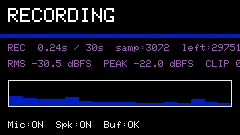

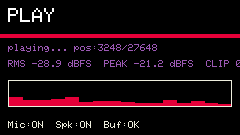

### IMU viewer — background palette (KEY1)

Each KEY1 click advances the color and plays the matching note (black is silent):

| | | | |
|:---:|:---:|:---:|:---:|
| 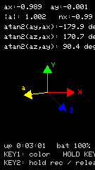 black (silent) | 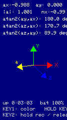 navy · C4 · 261.63 Hz | 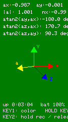 darkgreen · D4 · 293.66 Hz | 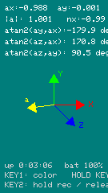 darkcyan · E4 · 329.63 Hz |
| 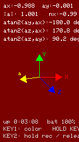 maroon · F4 · 349.23 Hz | 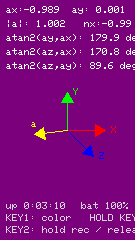 purple · G4 · 392.00 Hz | 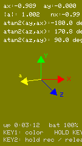 olive · A4 · 440.00 Hz | 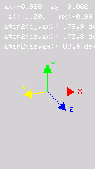 lightgrey · B4 · 493.88 Hz |
| 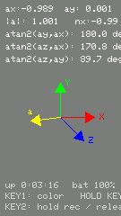 darkgrey · C5 · 523.25 Hz | 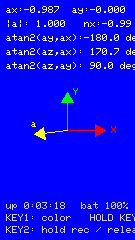 blue · D5 · 587.33 Hz | 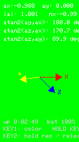 green · E5 · 659.25 Hz | 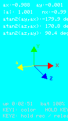 cyan · F5 · 698.46 Hz |
| 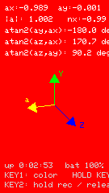 red · G5 · 783.99 Hz | 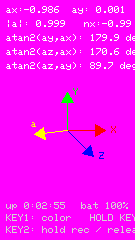 magenta · A5 · 880.00 Hz | 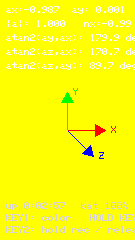 yellow · B5 · 987.77 Hz | 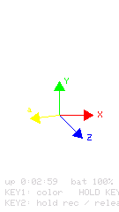 white · C6 · 1046.50 Hz |

## Audio implementation notes (important)

The StickS3 audio path uses a shared codec (ES8311). Switching between mic and speaker requires explicit ordering to avoid “no audio” states.

In [src/main.cpp](src/main.cpp), the helpers `ensureSpeakerOn()`, `ensureSpeakerOff()`, and `ensureMicOff()` are intentionally used whenever transitioning between recording and playback.

Recording details:

- Sample rate: **16 kHz**, mono
- Buffer: allocated at runtime, **PSRAM preferred** (`ps_malloc`), then heap fallback
- Codec: **IMA ADPCM** encode/decode stored in RAM (used to validate the pipeline; playback uses `M5.Speaker.playRaw()`)

## Build / Upload (VS Code PlatformIO)

This project is meant to be built with the **PlatformIO VS Code extension** (not the terminal CLI).

- Environment: `m5stack-sticks3` (see [platformio.ini](platformio.ini))
- Upload port: `/dev/ttyACM0` (configured in [platformio.ini](platformio.ini))

Use VS Code commands:

- `PlatformIO: Build`
- `PlatformIO: Upload`
- `PlatformIO: Monitor`
- If something gets stuck: `PlatformIO: Clean` then `PlatformIO: Upload`

A successful build also refreshes [firmware/](firmware/) (address-suffixed bins for M5Burner) via [scripts/gen_firmware_dir.py](scripts/gen_firmware_dir.py).

## M5Burner (official catalog)

This repo is laid out for a PR into [m5stack/M5Stack-Firmware](https://github.com/m5stack/M5Stack-Firmware):

- Manifest: [m5burner.json](m5burner.json) (includes `cover` + `images` pointing at the three store shots)
- Cover / store shots: [images/](images/) — `recording.png`, `play.png`, `normal.png`
- Flash images: [firmware/](firmware/) (`name_0xADDR.bin`)
- After first review, add this repo URL to their `firmware-repo.list`

StickS3 download mode (native USB): hold the **power button** until the green LED blinks, release, then flash; short-click power to boot the app.

## Releases (prebuilt binaries)

This repo includes a GitHub Actions workflow that builds firmware binaries and attaches them to a GitHub Release.

- **Automatic releases:** every push to `main` publishes a new **pre-release** and automatically increments the **patch** version (`vX.Y.Z`).
- **Manual releases:** you can also publish a normal release by pushing a version tag.
- Create a tag like `v0.0.1` and push it:
  - `git tag v0.0.1`
  - `git push --tags`
- After the workflow finishes, download the `.zip` / `.bin` assets from the GitHub Release page.

## Repo map

- Main firmware: [src/main.cpp](src/main.cpp)
- PlatformIO config / deps: [platformio.ini](platformio.ini)
- M5Burner manifest: [m5burner.json](m5burner.json)
- M5Burner cover images: [images/](images/)
- M5Burner binaries: [firmware/](firmware/)
- Full screenshot set: [docs/screenshots/](docs/screenshots/)

## Optional: secrets

There is a template for Wi‑Fi credentials at [include/secrets.example.h](include/secrets.example.h) (copy to `include/secrets.h`). The current demo firmware does not require Wi‑Fi, but the repo keeps this in place for future work.
